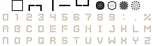

# Othello (Reversi) in MATLAB

A two-player Othello game I built for the Fundamentals of Engineering course at Ohio State (spring 2024).
Players take turns clicking a square; the game only accepts legal moves, flips every captured disc,
skips a player who has no legal move, keeps score, and announces the winner.

## Run it

1. Open this folder in MATLAB.
2. Run `Reversi.m`.
3. Click a highlighted square to place a disc. The menu button lets you reset or end the game.

## How it works

- `Reversi.m` holds the game: the board is an 8×8 matrix, and a move is legal when it captures
  discs in at least one of the eight directions (`isValidMove`, `checkDir`, `resolveMove`).
  After each move it recounts the score and passes the turn, or keeps it if the other player
  is blocked (`updateTurn`).
- `simpleGameEngine.m` draws the board from the sprites in `SpriteSheet.png` and reads mouse
  clicks. It was provided by the course; I did not write it.

## Documents

- [User manual](User-Manual-Othello.pdf): how to play.
- [Program description for developers](Program-Description-for-Developers-Othello.pdf): how the code is organized.
